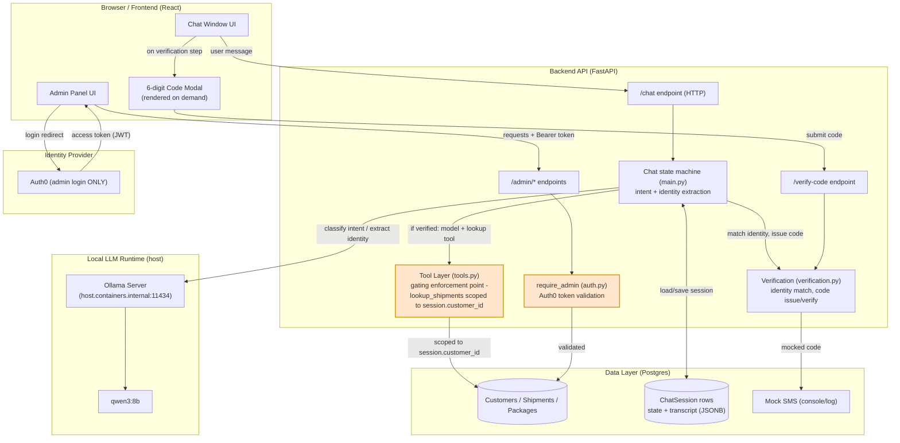
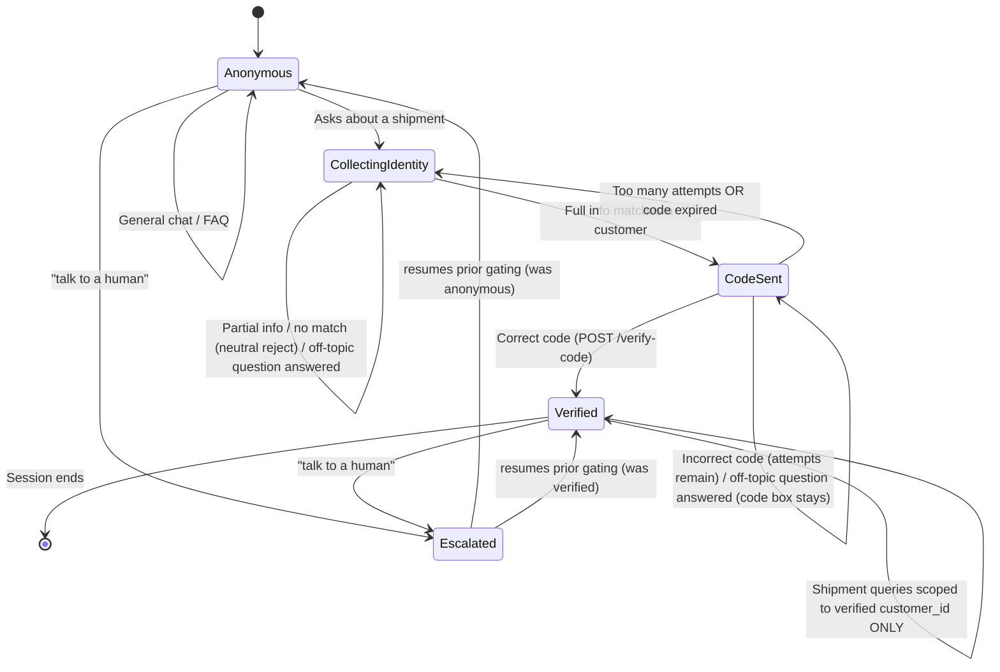
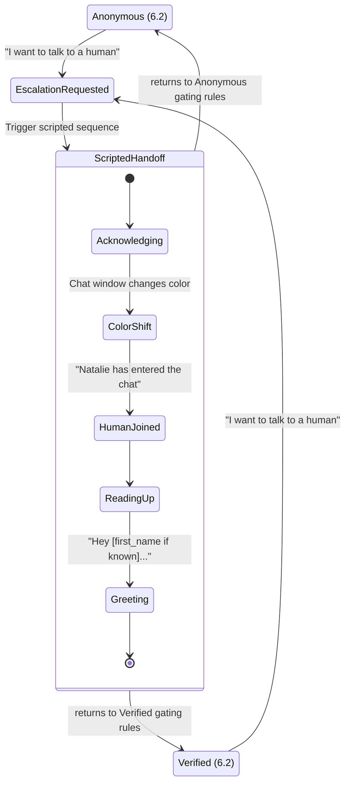
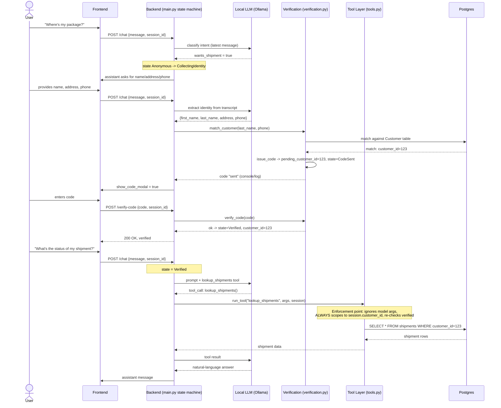
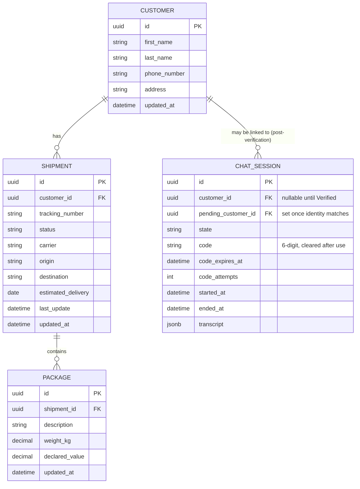
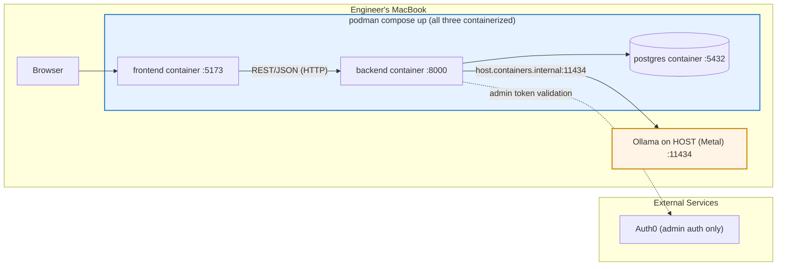

# SecureShip Architecture Diagrams

Regenerated against the real implementation (the build we chose: **HTTP transport + Podman with
Ollama on the host**). These reflect the actual code, not the spec templates: identity collection
and 2FA are driven by the backend state machine (not model tool calls), the model's only tool is
`lookup_shipments`, and session state lives in the Postgres `ChatSession` row (there is no separate
in-memory store). The WebSocket (6.3b) and fully-containerized-Ollama (6.5 bonus) variants are
intentionally omitted - they live in `docs/project-requirements.md` if needed.

## 1. High-level system architecture (6.1)

## 2. Conversation / identity-gating state machine (6.2)

The contract the backend enforces. These are the actual persisted states
(`verification.py`): `anonymous`, `collecting_identity`, `code_sent`, `verified`,
`escalated_to_human`. A non-matching identity is a neutral reject that stays in
`collecting_identity`; an expired or locked-out code drops back to `collecting_identity`
(there is no separate `IdentityRejected` / `AwaitingCode` / `CodeExpired` state).

## 2b. Human escalation sequence (6.2b, Epic G - cosmetic)

## 3. Tool-calling sequence - HTTP (6.3, the gating enforcement point)

Identity collection and 2FA are backend-driven (intent classification + identity extraction +
`match_customer`), not model tool calls. The model is handed exactly one tool, `lookup_shipments`,
and only in the verified branch. A turn that contains a tracking number or "list all" phrasing
calls `run_tool` directly without the model, but the model-tool path below is the representative
case.

## 4. Data model (6.4 ERD)

## 5. Deployment / local dev topology (6.5 - our baseline)

