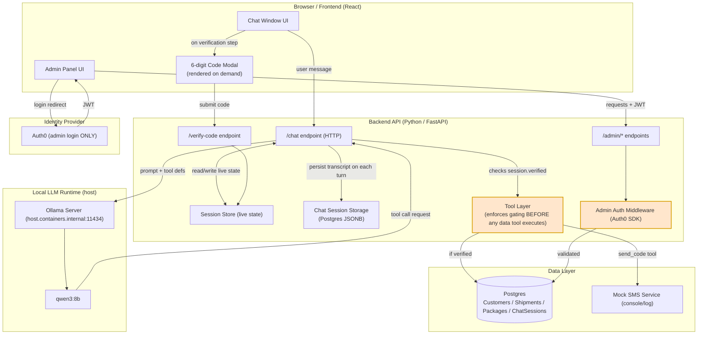
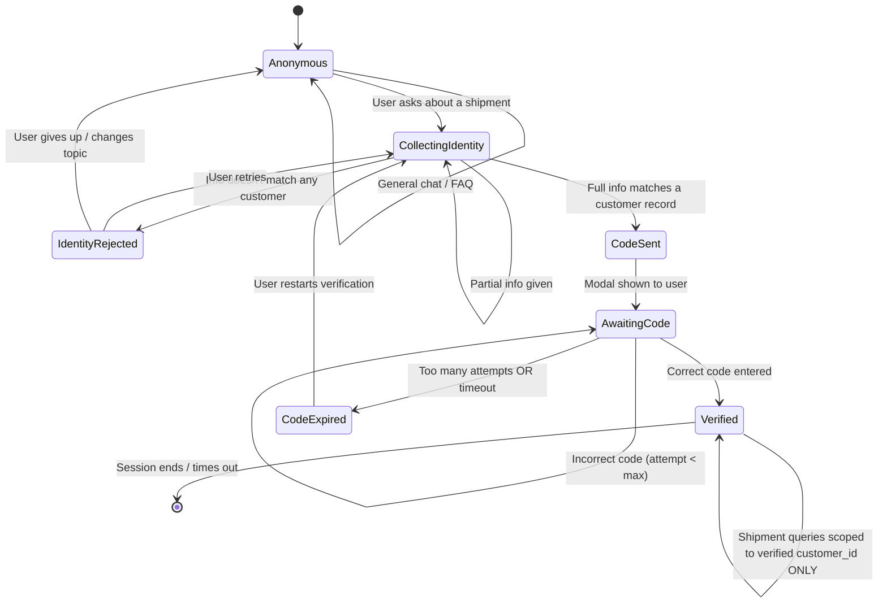
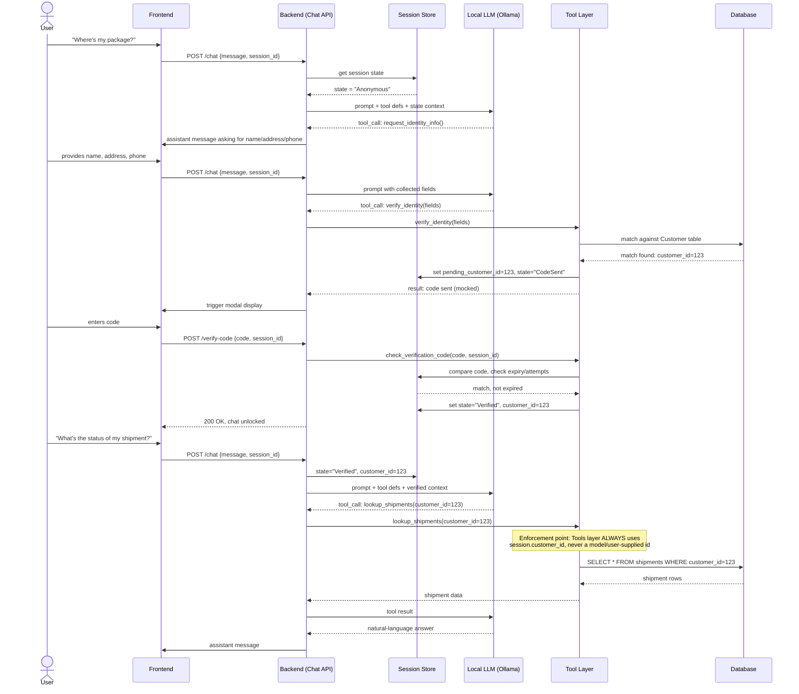
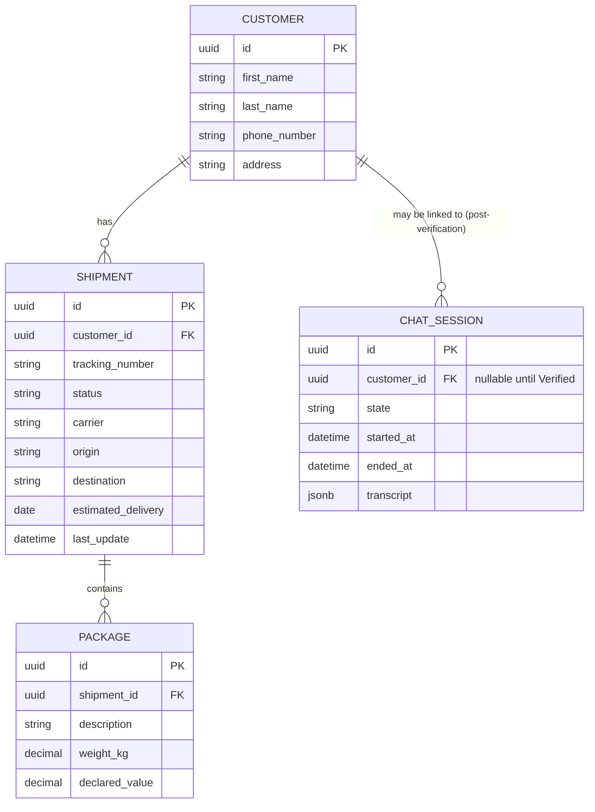
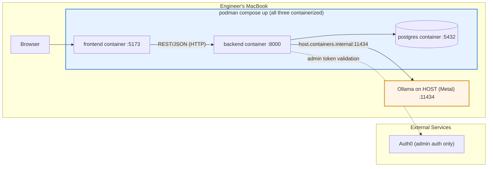

# SecureShip Architecture Diagrams

Starting-reference diagrams from the spec (Section 6), covering the build path we chose:
**HTTP transport + Podman with Ollama on the host**. These get regenerated against the real
implementation in Week 5. The WebSocket (6.3b) and fully-containerized-Ollama (6.5 bonus)
variants are intentionally omitted here - they live in `docs/project-requirements.md` if needed.

## 1. High-level system architecture (6.1)

## 2. Conversation / identity-gating state machine (6.2)

The contract the backend must enforce (implemented Week 2; Week 1 stays in Anonymous).

## 2b. Human escalation sequence (6.2b, Epic G - cosmetic)

## 3. Tool-calling sequence - HTTP (6.3, the gating enforcement point)

## 4. Data model (6.4 ERD)

## 5. Deployment / local dev topology (6.5 - our baseline)

